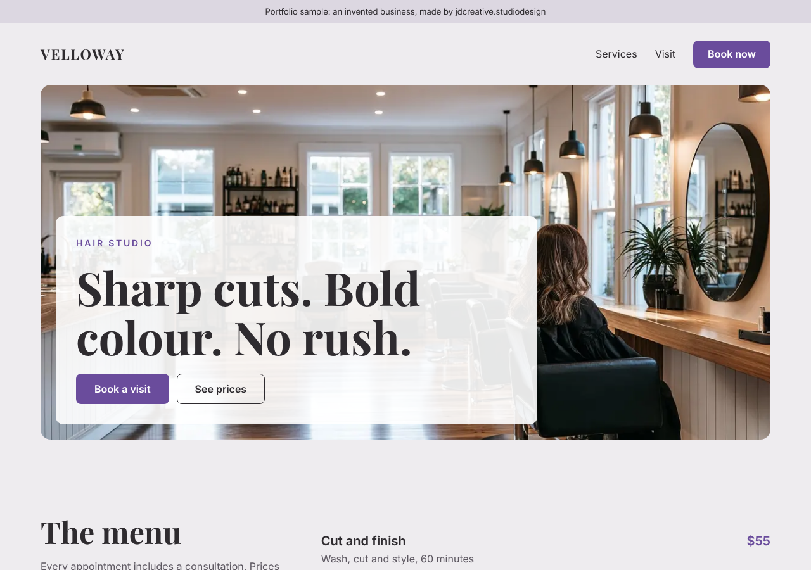
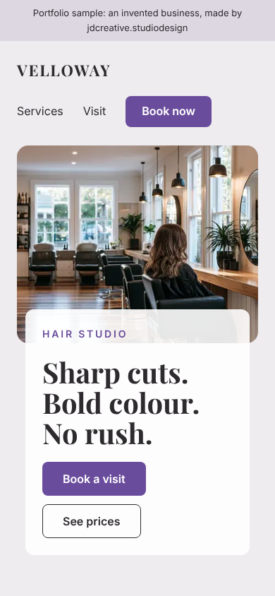

# Velloway Hair Studio: landing page with online booking

[](https://github.com/jdcreativestudiodesign-ux/velloway-salon/actions/workflows/test.yml)

**Portfolio sample by jdcreative.studiodesign.** The salon, its prices and its details are invented. The page, the booking form and the tests are real.

A fast, mobile-first one-page site for a small hair salon: services and prices, opening hours, and a booking-request form that checks each request before it is accepted.



## Run it

You need Node.js 22 or newer.

```
npm ci
npm run dev
```

Then open http://localhost:3000.

## What it does

- **One clear page:** a hero with two calls to action, the service menu with prices, a booking form, and visiting details.
- **Booking requests that make sense:** the form refuses days the salon is closed (Sunday and Monday), past days, days more than 60 days ahead, and evening slots on Saturday, when the salon closes at 16:00. Each problem is shown in plain English next to its field, and nothing the visitor typed is lost.
- **The salon's own calendar:** "today" is worked out in the salon's time zone, not the server's, so a late-evening request for the same day still works.
- **Works without JavaScript:** the form is a standard HTML form backed by a Next.js Server Action, so it works before scripts load, or if they fail.
- **Simple spam protection:** a hidden field that people never see but simple bots fill in. Bots get a polite reply and nothing is processed.
- **Accessible:** real labels on every field, errors linked to their fields for screen readers, a skip link, visible keyboard focus, 44 px or larger tap targets, and text colours that pass WCAG AA contrast.
- **Self-hosted fonts:** Playfair Display and Inter are bundled with the site, so no visitor data goes to a font service.
- **Kept out of search results**, because the business is invented.

This is a demo, so booking requests are checked and confirmed on screen but not stored or sent anywhere. In a real project, the request would go to the salon's email or booking system at the marked spot in `src/app/actions.ts`.



## Tests

```
npm test                  # 51 tests (Vitest and Testing Library)
./negative-controls.sh    # plants 14 bugs, one at a time; the tests must catch all 14
npm run lint
npm run typecheck
npm run build
```

The tests cover every booking rule, including the edges: today, yesterday, the last day of the booking window, impossible dates such as 30 February, and the salon's time zone. They also cover the form's error messages, the page's structure and every photo file. GitHub Actions runs all of the checks above on every push.

## How it's built

| Part | Where |
| --- | --- |
| Page sections | `src/app/page.tsx` |
| Business details, services, hours | `src/lib/salon.ts` |
| Booking rules (pure functions) | `src/lib/booking.ts` |
| Server Action for the form | `src/app/actions.ts` |
| Form with field-by-field errors | `src/components/BookingForm.tsx` |
| Photos and their descriptions | `src/lib/photos.ts`, `public/images/` |
| Colours, type and layout | `src/app/globals.css` |

**Stack:** Next.js 16 (App Router), React 19, TypeScript, plain CSS, Vitest, Testing Library.

Tool versions follow what the official Next.js lint setup supports today: TypeScript 6.0 (TypeScript 7 is not supported by it yet) and ESLint 9.39, the last ESLint 9 release (its React, accessibility and import plugins don't support ESLint 10 yet). ESLint 9 prints an end-of-support notice on install; the move to 10 happens once those plugins support it.

**Photos:** generated art, shipped as stripped web copies: rebuilt from pixels only, with no EXIF, XMP, ICC profile, comments, account details or prompts. Tests pin each image by its SHA-256 hash, check that its structure holds no metadata section, and check its size and screen-reader description. Next.js serves them as resized WebP files, and only the `public/images` folder can be resized.

## Licence

All rights reserved. Shared for portfolio viewing only. See [LICENSE](LICENSE).
